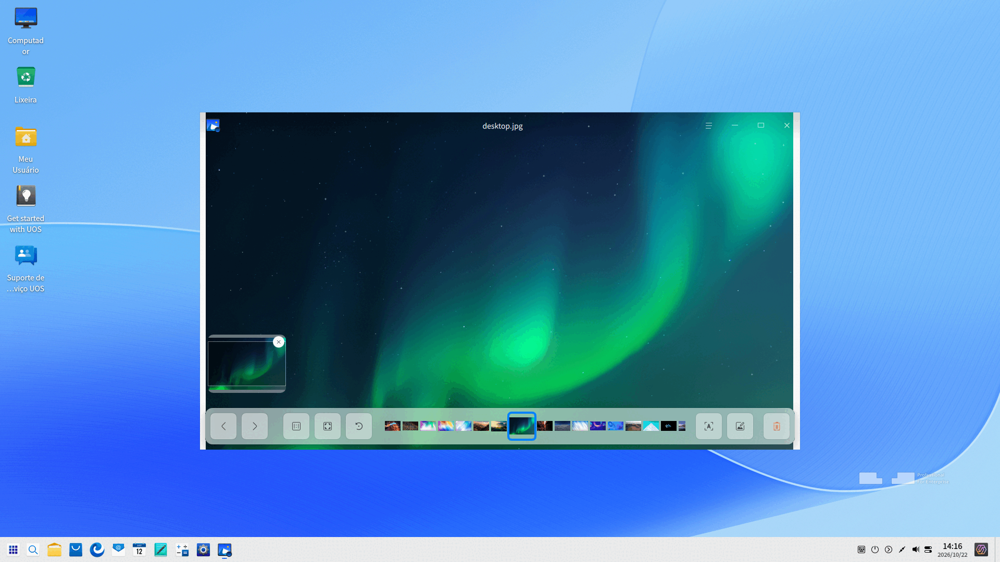
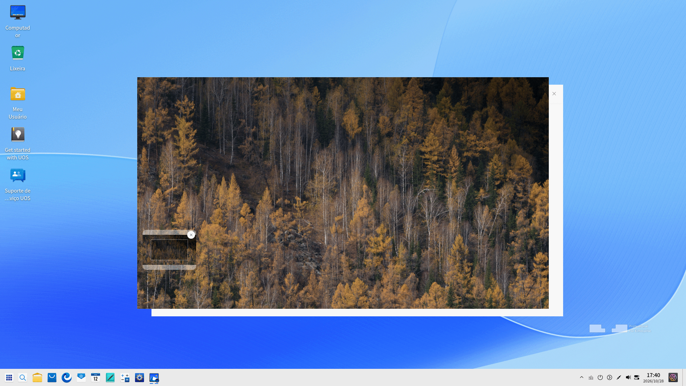
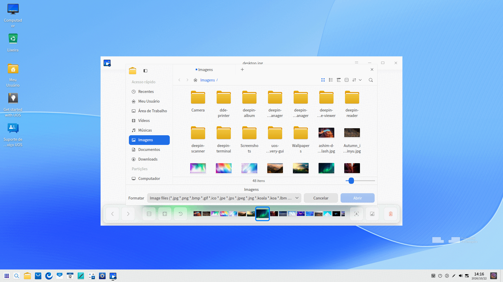
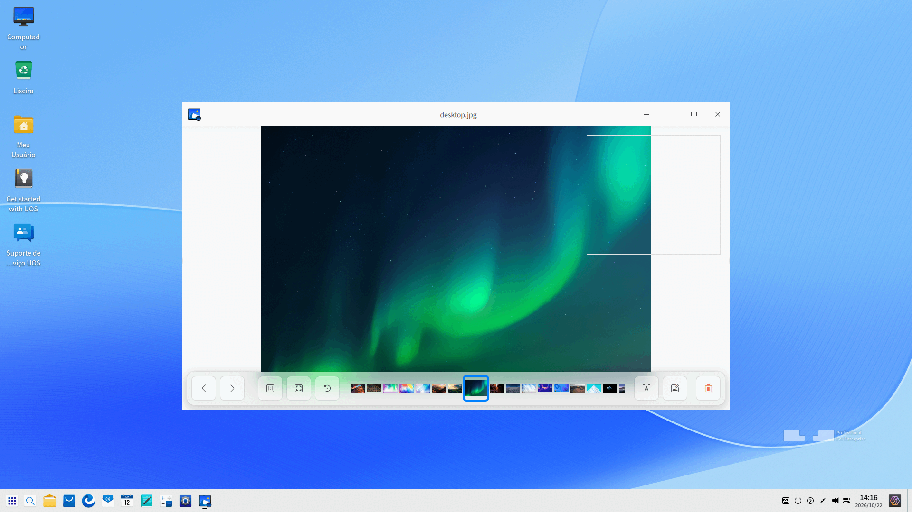
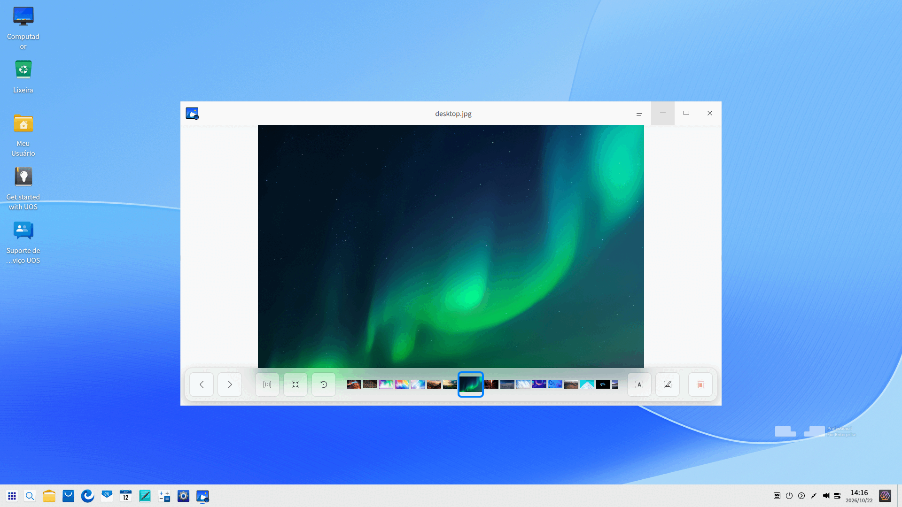

# Visualizador de Imagens|deepin-image-viewer|

## Visão Geral

O Visualizador de Imagens é um visualizador leve, com visual moderno e desempenho fluido. Com suporte a uma ampla variedade de formatos de imagem, ele combina facilidade de uso e recursos avançados.

## Guia

Você pode executar, fechar e criar um atalho na área de trabalho para o Visualizador de Imagens das seguintes maneiras:

### Executar o Visualizador de Imagens

1. Clique no ícone do Iniciador  no Dock para abrir a interface do Iniciador.
2. Localize o Visualizador de Imagens  rolando a roda do mouse ou pesquisando por "visualizador de imagens" no Iniciador.
3. Clique com o botão direito em  e você poderá:
 - Clicar em **Enviar para a área de trabalho** para criar um atalho na área de trabalho.
 - Clicar em **Fixar no dock** para fixá-lo no Dock.
 - Clicar em **Adicionar à inicialização** para que o aplicativo seja executado automaticamente ao iniciar o sistema.

### Sair do Visualizador de Imagens

- Na interface do Visualizador de Imagens, clique em  para sair.
- Clique com o botão direito em  no Dock e selecione **Fechar tudo** para sair.
- Clique em  na interface do Visualizador de Imagens e selecione **Sair** para fechar o aplicativo.

### Exibir Atalhos 

Na interface do Visualizador de Imagens, pressione **Ctrl + Shift + ?** no teclado para visualizar os atalhos.

## Visualização de Imagens

### Abrir Imagens

Você pode usar uma das seguintes formas para abrir arquivos de imagem:

- Clique com o botão direito em uma imagem e selecione **Abrir com** > **Visualizador de Imagens**.
- Dê um clique duplo na imagem se o Visualizador de Imagens já estiver definido como o aplicativo padrão para exibição de imagens.
- Abra o Visualizador de Imagens, clique em **Abrir Imagem** e selecione o arquivo a ser aberto.
- Abra o Visualizador de Imagens e arraste o arquivo diretamente para a janela do aplicativo.
- Arraste a imagem até o ícone do Visualizador de Imagens na área de trabalho ou no Dock.

>  Dicas: No Centro de Controle, você pode definir o Visualizador de Imagens como o aplicativo padrão. Consulte [Aplicativos Padrão](dman:///dde#Default Applications) para operações específicas.

Os seguintes formatos de imagem são suportados: BMP, ICO, JPG/JPE/JPEG, PNG, TGA, TIF/TIFF, XPM, GIF, WEBP, CR2, NEF, DNG, RAF, MEF, MRW, XBM, SVG, ORF, MNG, etc.

### Interface Principal

| Ícone | Nome | Descrição |
| ------------------------------------------------------ | ----------------------- | --------------------------------------------------------- |
|  | Anterior | Alterna para a imagem anterior. |
|  | Próxima | Alterna para a próxima imagem. |
|  | Tamanho 1:1 | Exibe a imagem em tamanho real (1:1). |
|  | Ajustar à janela | Redimensiona a imagem para adaptá-la à janela atual. |
|  | Extrair texto | Reconhece os textos contidos na imagem (OCR). |
|  | Girar | Gira a imagem 90 graus no sentido anti-horário. |
|  | Excluir | Exclui a imagem atual. |

>  Notas: Não é possível renomear, girar ou excluir imagens do sistema.

### Mostrar/Ocultar a Janela de Navegação

1. Na interface do Visualizador de Imagens, clique em  na barra de ferramentas ou role a roda do mouse para ampliar a imagem. Se as dimensões da imagem excederem a área da janela, uma janela de navegação aparecerá no canto inferior esquerdo.

2. Arraste o retângulo na janela de navegação para visualizar a área desejada da imagem.

3. Clique em  na janela de navegação ou clique com o botão direito na imagem e selecione **Ocultar janela de navegação** para fechá-la.

   A janela de navegação não será exibida na próxima vez após ser fechada; clique com o botão direito na imagem e selecione **Mostrar janela de navegação** para reexibi-la.

### Imprimir Imagens

1. Clique com o botão direito na imagem na interface do Visualizador de Imagens e selecione **Imprimir**.
2. Selecione a impressora e configure os parâmetros de impressão.
3. Clique em **Imprimir**.

### Extrair Textos

1. Clique em  na barra de ferramentas ou clique com o botão direito e selecione **Extrair texto** para acessar a interface de extração de texto e reconhecer os caracteres na imagem.

2. Você pode editar, copiar ou salvar os textos reconhecidos no formato TXT.

   

### Renomear Imagens

1. Clique com o botão direito na imagem na interface do Visualizador de Imagens e selecione **Renomear**.
2. Digite o novo nome na caixa de diálogo pop-up.
3. Clique em **Confirmar** para renomear o arquivo.

### Apresentação de Slides

1. Clique com o botão direito na imagem na interface do Visualizador de Imagens.
2. Selecione **Apresentação de slides** e todas as imagens serão reproduzidas em sequência em tela cheia.
3. Pressione a tecla **Esc** para sair da apresentação de slides.

### Copiar Imagens

1. Clique com o botão direito na imagem na interface do Visualizador de Imagens e selecione **Copiar**.
2. Na área de trabalho ou na pasta de destino, clique com o botão direito em uma área vazia e selecione **Colar** para copiar o arquivo.

### Girar Imagens

1. Clique com o botão direito na imagem na interface do Visualizador de Imagens e selecione **Girar no sentido horário** ou **Girar no sentido anti-horário**.
2. A imagem será girada 90 graus no sentido escolhido.

### Definir como Papel de Parede

Você pode definir uma imagem como papel de parede da área de trabalho. Clique com o botão direito na imagem no Visualizador de Imagens e selecione **Definir como papel de parede**.

### Exibir no Gerenciador de Arquivos

1. Clique com o botão direito na imagem no Visualizador de Imagens e selecione **Exibir no gerenciador de arquivos**.
2. A pasta que contém a imagem será aberta e o arquivo será destacado.

### Exibir Informações da Imagem

Você pode visualizar as informações detalhadas da imagem.
1. Clique com o botão direito na imagem no Visualizador de Imagens e selecione **Informações da imagem**.
2. A janela de informações será aberta, exibindo dados detalhados sobre o arquivo.

### Editar Imagens

No modo de navegação, clique no ícone de edição na barra de ferramentas ou pressione **Ctrl + Shift + E** para entrar no modo de edição.

No modo de edição, a barra de navegação e a faixa de miniaturas são ocultadas, e a barra de ferramentas de edição aparece na parte inferior da janela. Você pode usar ferramentas de caneta, linha, seta, retângulo, elipse, texto, desfoque e corte.

- A ferramenta de Texto inclui os modos Texto Simples e Etapas Numeradas.
- A ferramenta de Desfoque inclui os modos Desfoque Gaussiano, Mosaico e Grafite.
- Pressione **Ctrl + Z** para desfazer e **Ctrl + Y** para refazer. Selecione uma anotação e pressione **Delete** para removê-la.

Ao concluir a edição, clique no ícone Salvar Cópia. A imagem editada é salva em seu formato original na pasta da imagem de origem, mantendo o arquivo original inalterado.
Pressione **Esc** ou clique no ícone fechar na barra de ferramentas de edição para sair. Se houver alterações não salvas, escolha **Salvar cópia**, **Não salvar** ou **Cancelar**.

### Excluir Imagens

Você pode excluir imagens do Visualizador de Imagens das seguintes maneiras:

- Clique no ícone  na interface do Visualizador de Imagens.
- Clique com o botão direito na imagem e selecione **Excluir**.
- Pressione a tecla **Delete** no teclado enquanto visualiza a imagem.

## Menu Principal

No menu principal, você pode alternar temas da janela, consultar o manual de ajuda e obter mais informações sobre o Visualizador de Imagens.

### Tema

A interface oferece três opções de temas: Tema Claro, Tema Escuro e Tema do Sistema.

1. Na interface do Visualizador de Imagens, clique em .
2. Clique em **Tema** para selecionar o tema visual de sua preferência.

### Ajuda
1. Na interface do Visualizador de Imagens, clique em .
2. Clique em **Ajuda** para visualizar o manual do Visualizador de Imagens.

### Sobre

1. Na interface do Visualizador de Imagens, clique em .
2. Clique em **Sobre** para visualizar a versão e a apresentação do Visualizador de Imagens.

### Sair

1. Na interface do Visualizador de Imagens, clique em .
2. Clique em **Sair** para fechar o Visualizador de Imagens.
